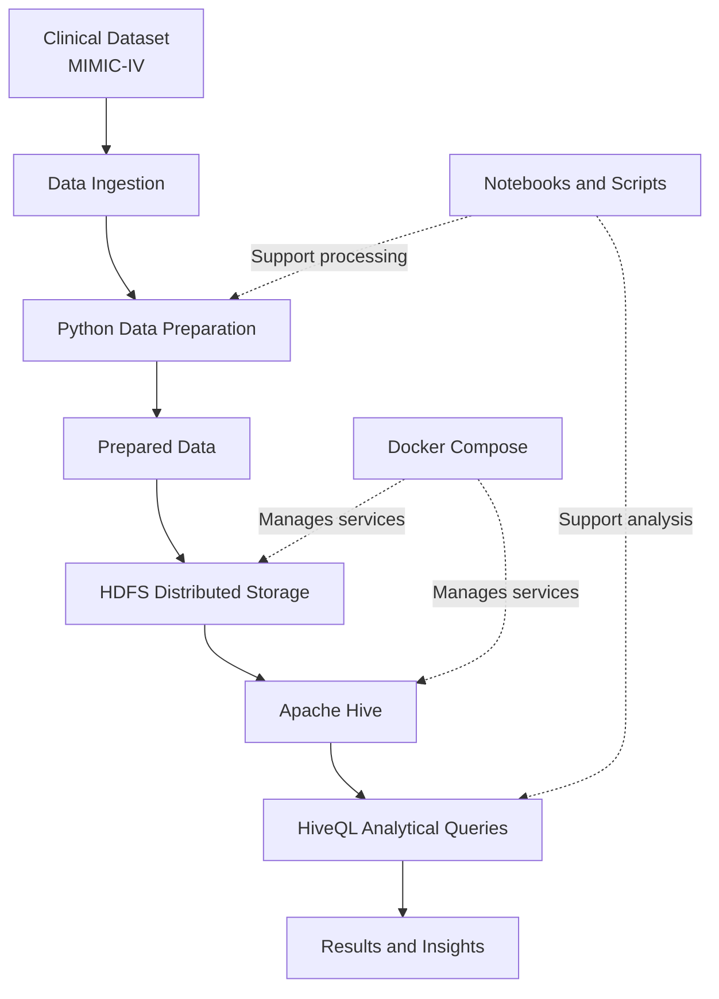

# 🏥 Healthcare Big Data Analytics

<p align="center">
  <strong>A Docker-Based Big Data Pipeline for Clinical Data Processing and Healthcare Analytics</strong>
  <br/>
  An academic project exploring distributed storage, data processing, and SQL-based analytics using the Hadoop ecosystem.
</p>

<p align="center">
  
  
  
  
  
</p>

<p align="center">
  <a href="https://github.com/AkashSamanta2/Healthcare-Big-Data-Analytics">Repository</a> •
  <a href="https://github.com/AkashSamanta2/Healthcare-Big-Data-Analytics/issues">Issues</a> •
  <a href="https://github.com/AkashSamanta2/Healthcare-Big-Data-Analytics/blob/main/Project_Report_Document.pdf">Project Report</a> •
  <a href="https://github.com/AkashSamanta2/Healthcare-Big-Data-Analytics/blob/main/BDA_Project_PPT.pdf">Presentation</a>
</p>

---

## 📌 Table of Contents

- [Overview](#-overview)
- [Objectives](#-objectives)
- [Key Features](#-key-features)
- [Technology Stack](#-technology-stack)
- [System Architecture](#-system-architecture)
- [Repository Structure](#-repository-structure)
- [Getting Started](#-getting-started)
- [Running the Pipeline](#-running-the-pipeline)
- [Healthcare Analytics Workflow](#-healthcare-analytics-workflow)
- [Results and Documentation](#-results-and-documentation)
- [Data and Privacy](#-data-and-privacy)
- [Troubleshooting](#-troubleshooting)
- [Future Improvements](#-future-improvements)
- [Author](#-author)
- [License](#-license)

---

## 🔍 Overview

**Healthcare Big Data Analytics** is an academic project focused on applying big data technologies to healthcare data processing and analysis.

Healthcare datasets can contain large volumes of structured clinical information, including patient demographics, hospital admissions, diagnoses, and clinical outcomes. Processing such data efficiently requires appropriate storage, data preparation, and analytical tools.

This project explores a containerized data-processing workflow built around **Docker, Apache Hadoop, HDFS, Apache Hive, Python, and SQL**. It organizes the project into dedicated directories for data, scripts, source code, SQL queries, notebooks, and reports.

The project uses the MIMIC-IV healthcare database as its intended clinical-data context. Access to the underlying dataset is subject to its applicable access requirements.

### 🎯 Project Goals

- Organize and prepare healthcare data for analysis.
- Explore distributed storage through Hadoop Distributed File System (HDFS).
- Use containerization to simplify environment setup and service management.
- Apply SQL-based analytical queries through Apache Hive.
- Investigate clinically relevant patterns in hospital admissions and patient outcomes.
- Maintain a reproducible, well-documented workflow for academic experimentation.

---

## ✨ Key Features

| Feature                      | Description                                                |
| ---------------------------- | ---------------------------------------------------------- |
| 🐳 Containerized environment | Run supported infrastructure services using Docker.        |
| 🗄️ Distributed storage     | Use HDFS to organize and access healthcare data.           |
| 🐍 Data preparation          | Use Python for data cleaning and transformation.           |
| 🐝 SQL analytics             | Define tables and analyze structured data using HiveQL.    |
| 📓 Exploratory analysis      | Organize notebooks for experiments and data exploration.   |
| ⚙️ Automation              | Keep reusable pipeline scripts in a dedicated directory.   |
| 📊 Documentation             | Include the project report and presentation for reference. |

---

## 🛠️ Technology Stack

| Technology              | Role                                                |
| ----------------------- | --------------------------------------------------- |
| Python                  | Data preparation, transformation, and analysis      |
| Docker & Docker Compose | Containerized environment and service orchestration |
| Apache Hadoop           | Distributed data-processing ecosystem               |
| HDFS                    | Distributed file storage                            |
| Apache Hive             | SQL-based querying and data warehousing             |
| SQL / HiveQL            | Analytical queries and table definitions            |
| Jupyter Notebook        | Interactive exploration and experimentation         |
| Git & GitHub            | Version control and project documentation           |

*The exact versions and service configuration should be taken from the repository's Docker and dependency files.*

---

## 🏗️ System Architecture

The intended workflow separates data preparation, distributed storage, and analytical querying.



### Architecture Components

1. **Data source:** Clinical tables and other permitted healthcare data files.
2. **Data preparation:** Python scripts can be used to validate, clean, and transform data.
3. **Distributed storage:** HDFS provides a filesystem interface for storing prepared datasets.
4. **Query layer:** Hive provides a SQL-like interface to structured data stored in the Hadoop environment.
5. **Analysis and reporting:** SQL queries, notebooks, and project documentation support the interpretation of results.

*The diagram represents the intended workflow; the execution status of each stage depends on the available configuration and data.*

---

## 📂 Repository Structure

```text
Healthcare-Big-Data-Analytics/
│
├── data/                       # Healthcare data and data-related resources
│
├── docker/                     # Docker and service configuration
│
├── notebooks/                  # Jupyter notebooks and experiments
│
├── reports/                    # Supporting reports and analytical outputs
│
├── scripts/                    # Automation and data-processing scripts
│
├── sql/                        # SQL / HiveQL queries and table definitions
│
├── src/                        # Project source code
│
├── .gitignore                  # Files excluded from version control
│
├── requirements.txt            # Python dependencies
│
├── BDA_Project_PPT.pdf         # Project presentation
│
├── Project_Report_Document.pdf # Project report
│
└── README.md                   # Project documentation
```

*Directory contents may evolve as the project develops.*

---

## 🚀 Getting Started

### Prerequisites

Install the following tools before running the project:

- [Git](https://git-scm.com/downloads)
- [Docker Desktop](https://www.docker.com/products/docker-desktop/) or Docker Engine
- Docker Compose
- [Python](https://www.python.org/downloads/) compatible with `requirements.txt`
- A terminal such as PowerShell, Bash, or the VS Code integrated terminal

For a local Hadoop environment, allocate sufficient memory and disk space to the configured containers.

### 1. Clone the Repository

```bash
git clone https://github.com/AkashSamanta2/Healthcare-Big-Data-Analytics.git

cd Healthcare-Big-Data-Analytics
```

### 2. Inspect the Project Configuration

```bash
git status
git ls-files
```

Inspect the `docker/` directory to identify the Docker Compose configuration file and service definitions before starting the environment.

### 3. Set Up the Python Environment

**Windows — PowerShell**

```powershell
python -m venv .venv

.\.venv\Scripts\Activate.ps1

python -m pip install --upgrade pip

python -m pip install -r requirements.txt
```

**Linux / macOS — Bash**

```bash
python3 -m venv .venv

source .venv/bin/activate

python -m pip install --upgrade pip

python -m pip install -r requirements.txt
```

If the project dependencies are installed inside a separate container, follow the corresponding Docker configuration instead.

### 4. Start the Docker Environment

Change to the directory containing the Compose file. For example, if it is located at `docker/docker-compose.yml`:

```bash
cd docker

docker compose config

docker compose up -d
```

If the Compose file has a different name or location, adjust the command accordingly.

Check the running containers:

```bash
docker compose ps
```

Inspect service logs if needed:

```bash
docker compose logs --tail=100
```

> **Note:** Starting containers does not automatically guarantee that HDFS, Hive, or the data-processing workflow is fully initialized. Verify service health before proceeding.

---

## ⚙️ Running the Pipeline

The following commands illustrate the typical execution sequence. Use the scripts and service names defined in your actual configuration.

### Step 1 — Verify the Hadoop Environment

After the Hadoop services are running, check HDFS availability:

```bash
docker exec -it namenode hdfs dfsadmin -report
```

Check the HDFS root directory:

```bash
docker exec -it namenode hdfs dfs -ls /
```

> The container must actually be named `namenode` for these commands to work. Otherwise, replace it with the configured NameNode service or container name.

### Step 2 — Prepare HDFS Directories

Create a directory for project data:

```bash
docker exec -it namenode hdfs dfs -mkdir -p /data/raw

docker exec -it namenode hdfs dfs -mkdir -p /data/processed
```

Check the directories:

```bash
docker exec -it namenode hdfs dfs -ls /data
```

### Step 3 — Upload the Dataset

Place the permitted input files in the location expected by the project's ingestion scripts.

For example, to upload an available CSV file:

```bash
docker exec -it namenode hdfs dfs -put \
  /path/inside/container/input.csv \
  /data/raw/
```

Replace the example path with the real file path inside the NameNode container.

If the repository includes an ingestion script, inspect and use its documented arguments rather than assuming that it accepts a particular directory layout.

### Step 4 — Execute Data Preparation

Review the relevant files under `scripts/` and `src/`. Run the project's actual preprocessing entry point after checking its dependencies, input paths, and command-line arguments.

### Step 5 — Run Hive Queries

Once the required data has been uploaded and the Hive tables have been initialized, execute the project's table-definition and analytical SQL files using the configured Hive interface.

The precise connection command depends on the HiveServer2 service name, JDBC URL, and authentication settings in the Compose configuration
